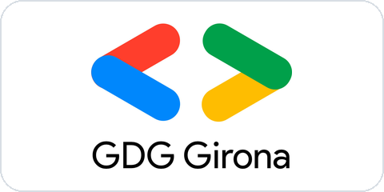

<a href="README.md">Read in English</a>

# Hola, soy Joan León ⚡️

**Web Performance Artisan.** Soy experto en rendimiento frontend, vivo en Girona y ayudo a equipos a construir webs que cargan rápido y responden al instante, porque la velocidad también es experiencia de usuario.

Soy el fundador de [PerfReviews](https://perf.reviews/), donde auditamos y optimizamos webs para mejorar sus Core Web Vitals, su conversión y la experiencia de las personas que las usan. Si tu web va lenta, [hablemos](https://perf.reviews/).

También soy Google Developer Expert en Web Technologies, Cloudinary Ambassador y organizador de [GDG Girona](https://gdg.community.dev/gdg-girona/) y [GeeksCAT](https://geekscat.org/).

  
  
  
  
  

## Proyectos destacados

- **[webperf-snippets](https://github.com/nucliweb/webperf-snippets)**: snippets de JavaScript probados para medir y depurar el rendimiento web. Tu agente de IA los ejecuta por ti, o los ejecutas tú en DevTools: el mismo código cada vez. [Documentación](https://webperf-snippets.nucliweb.net/)
- **[har-trace-viewer](https://github.com/nucliweb/har-trace-viewer)**: analizador y visor de HAR para ver cómo viaja la carga de una página entre CDN, origen y terceros, con análisis de caché y Core Web Vitals.
- **[webperf-debugging-devtools-mcp](https://github.com/nucliweb/webperf-debugging-devtools-mcp)**: depuración de rendimiento web con Chrome DevTools MCP y agentes de IA.
- **[image-element](https://github.com/nucliweb/image-element)**: buenas prácticas para imágenes en la web.

## Charlas y talleres

Hablo en conferencias y meetups sobre:

- Core Web Vitals: LCP, INP y CLS en proyectos reales
- Optimización de imágenes: formatos, imágenes responsive y la imagen LCP
- Depuración del rendimiento con Chrome DevTools
- Agentes de IA y Chrome DevTools MCP para auditorías de rendimiento determinísticas
- Renderizado y trabajo en el hilo principal: Long Animation Frames, yielding, `content-visibility`

Material de talleres: [Image Optimization Workshop](https://github.com/nucliweb/image-optimization-workshop) (en inglés).

¿Quieres que vaya a tu evento? Escríbeme en [X](https://x.com/nucliweb), [Bluesky](https://bsky.app/profile/nucliweb.net) o [LinkedIn](https://www.linkedin.com/in/joanleon/).

## Escribo

Escribo sobre rendimiento web en [joanleon.dev](https://joanleon.dev/). Algunos posts para empezar:

- [Guía práctica del elemento ``: de lo básico a LCP](https://joanleon.dev/posts/guia-practica-elemento-img/)
- [Yield to Main: setTimeout vs queueMicrotask vs scheduler.postTask](https://joanleon.dev/posts/yield-to-main-optimize-inp/)
- [Chrome DevTools para depurar el rendimiento de una web](https://joanleon.dev/posts/chrome-devtools-debugging-2025/)
- [La ventana móvil de 28 días de CrUX](https://joanleon.dev/posts/crux-28-day-window/)
- [IA en auditorías de Web Performance: medición determinística e informes accionables](https://joanleon.dev/posts/ai-web-performance-audits-scripts-reports/)

## Dónde encontrarme

[joanleon.dev](https://joanleon.dev/) · [X](https://x.com/nucliweb) · [Bluesky](https://bsky.app/profile/nucliweb.net) · [LinkedIn](https://www.linkedin.com/in/joanleon/)
