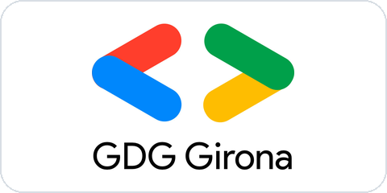

<a href="README.es.md">Leer en español</a>

# Hi, I'm Joan León ⚡️

**Web Performance Artisan.** I'm a frontend performance expert from Girona, and I help teams build websites that load fast and respond instantly, because speed is part of the user experience.

I'm the founder of [PerfReviews](https://perf.reviews/), where we audit and optimize websites to improve their Core Web Vitals, their conversion and the experience of the people who use them. If your site feels slow, [let's talk](https://perf.reviews/).

I'm also a Google Developer Expert in Web Technologies, a Cloudinary Ambassador and an organizer of [GDG Girona](https://gdg.community.dev/gdg-girona/) and [GeeksCAT](https://geekscat.org/).

  
  
  
  
  

## Featured projects

- **[webperf-snippets](https://github.com/nucliweb/webperf-snippets)**: tested JavaScript snippets that measure and debug web performance. Your AI agent runs them for you, or you run them yourself in DevTools: the same code every time. [Docs](https://webperf-snippets.nucliweb.net/)
- **[har-trace-viewer](https://github.com/nucliweb/har-trace-viewer)**: HAR analyzer and viewer to see how a page load travels through CDN, origin and third parties, with cache analysis and Core Web Vitals.
- **[webperf-debugging-devtools-mcp](https://github.com/nucliweb/webperf-debugging-devtools-mcp)**: web performance debugging with Chrome DevTools MCP and AI agents.
- **[image-element](https://github.com/nucliweb/image-element)**: curated best practices for images on the web.

## Talks & workshops

I speak at conferences and meetups about:

- Core Web Vitals: LCP, INP and CLS in real projects
- Image optimization: formats, responsive images and the LCP image
- Debugging performance with Chrome DevTools
- AI agents and Chrome DevTools MCP for deterministic performance audits
- Rendering and main thread work: Long Animation Frames, yielding, `content-visibility`

Workshop material: [Image Optimization Workshop](https://github.com/nucliweb/image-optimization-workshop).

Want me at your event? Reach me on [X](https://x.com/nucliweb), [Bluesky](https://bsky.app/profile/nucliweb.net) or [LinkedIn](https://www.linkedin.com/in/joanleon/).

## Writing

I write about web performance on [joanleon.dev](https://joanleon.dev/en/). A few posts to start with:

- [Practical guide to the `` element: from the basics to LCP](https://joanleon.dev/en/guia-practica-elemento-img/)
- [Yield to Main: setTimeout vs queueMicrotask vs scheduler.postTask](https://joanleon.dev/en/yield-to-main-optimize-inp/)
- [Chrome DevTools for Debugging Web Performance](https://joanleon.dev/en/chrome-devtools-debugging-2025/)
- [The CrUX 28-day rolling window](https://joanleon.dev/en/crux-28-day-window/)
- [AI in Web Performance Audits: Deterministic Measurement and Actionable Reports](https://joanleon.dev/en/ai-web-performance-audits-scripts-reports/)

## Find me

[joanleon.dev](https://joanleon.dev/) · [X](https://x.com/nucliweb) · [Bluesky](https://bsky.app/profile/nucliweb.net) · [LinkedIn](https://www.linkedin.com/in/joanleon/)
